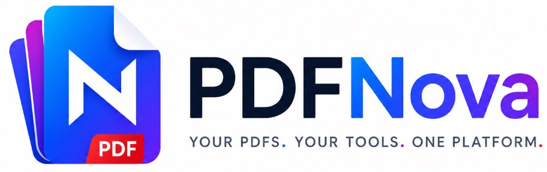

# PDFNova — Your PDFs. Your Tools. One Platform.

<p align="center">
  
</p>

[](LICENSE)
[](.github/workflows/deploy.yml)
[](#privacy-guarantee)
[](#architecture)

> **A modern, private, 100% client-side web application suite for all your PDF workflows.**  
> Inspired by iLovePDF and Stirling-PDF, designed to run completely inside your browser with **zero backend servers**, zero server uploads, and automated deployment on **GitHub Pages**.

---

## Highlights

- **100% Client-Side Privacy**: Medical summaries, hospital bills, contracts, and financial records **never leave your computer**. All processing occurs in browser WebAssembly & memory.
- **All-In-One Studio**: Complete unified workbench where you can swap pages, edit sentences, whiteout errors, sign, watermark, redact, protect, and compress in a single pipeline without switching tools.
- **Dr. Vijayapriya Aki Digital Signature**: Draggable & resizable placement box right on the page canvas with realistic handwriting fonts, draw pad, or image stamp.
- **Target Size Compression**: Compress PDFs to exact limits in **GB, MB, KB, or Bytes** for portal uploads and emails.
- **Searchable OCR & Text JPG to PDF**: Converts images to digital text PDFs while preserving original clinic header logos and branding photos.
- **Zero Hosting Costs**: Host for free on GitHub Pages, Cloudflare Pages, Netlify, or Vercel.

---

## Directory Structure

```
pdfnova/
├── index.html                 # Main single-page application entry point
├── assets/                    # Official PDFNova logos, favicons, and icons
│   ├── favicon.png
│   ├── favicon.svg
│   ├── pdfnova-brand.jpg
│   ├── pdfnova-icon.png
│   └── pdfnova-logo.png
├── css/
│   └── styles.css             # Clean, modern, responsive styling
├── js/
│   ├── app.js                 # Application router, search & tool registration
│   ├── pdf-engine.js          # Core PDF-Lib & PDF.js manipulation engine
│   ├── ui.js                  # Shared UI components, notifications, modals
│   └── tools/
│       ├── all-in-one.js      # All-In-One Studio unified workspace
│       ├── organize.js        # Merge, Split, Remove, Extract, Organize & Swap
│       ├── optimize.js        # Target size compress, Repair, OCR
│       ├── convert-to.js      # JPG to PDF, Word to PDF, HTML to PDF, MD to PDF
│       ├── convert-from.js    # PDF to JPG, PNG, and Text
│       ├── edit.js            # Rotate, Page Numbers, Watermark, Sign, Edit PDF
│       ├── security.js        # Protect (AES-256), Unlock, Compare, Redact
│       └── intelligence.js    # OCR Answer Tool, Summarizer, Translate, Markdown
├── .github/workflows/
│   └── deploy.yml             # Automated GitHub Pages CI/CD workflow
├── LICENSE                    # MIT Open Source License
├── README.md                  # Project documentation
└── serve.py                   # Lightweight local development server
```

---

## Included PDF Tools & Features

### 1. All-In-One Studio
* **Unified Pipeline**: Swap pages, rotate, edit sentences, whiteout typos, place signatures with corner resize handles, stamp text/image watermarks, redact data, compress to target file sizes, and encrypt with AES-256 passwords — all in one place.
* **Live Scaler**: Zoom up to 250% without pixelation or coordinate drift.

### 2. Organize PDF
* **Merge PDF**: Combine multiple PDFs into a single document with zero quality loss.
* **Split PDF**: Extract page ranges or burst pages into individual single-page documents bundled in a ZIP.
* **Remove Pages**: Interactive visual page thumbnail grid to delete unwanted pages.
* **Extract Pages**: Visually select specific pages and export them into a newly compiled document.
* **Organize & Swap PDF**: Drag-and-drop page reorganization, instant `Page A ⇄ Page B` swap dropdown, adjacent `←` / `→` shift buttons, and 90° rotation.
* **Scan to PDF**: Access device camera or webcam to take snapshots and compile into clean PDF files.

### 3. Optimize PDF
* **Compress PDF**: Compress by **Target File Size (GB/MB/KB/Bytes)** with live reduction calculations, or choose presets (Extreme ~75%, Recommended ~50%, Less ~25%).
* **Repair PDF**: Fix damaged cross-reference (xref) tables and reconstruct broken page structures.
* **OCR PDF**: Optical Character Recognition powered by **Tesseract.js** running in-browser.

### 4. Convert to PDF
* **JPG to PDF**: 
  * *Standard Image Mode*: Embeds photos in high resolution.
  * *Searchable OCR Mode*: Adds an invisible selectable text layer (Ctrl+F enabled).
  * *Digital Text Mode*: Crops and places clinic/company logos at the top while typesetting body text into selectable vector format.
* **Word (.docx) to PDF**: Parse formatted Microsoft Word documents client-side.
* **HTML to PDF**: Convert rich HTML/CSS templates into printable PDF files.
* **Markdown to PDF**: Live split-view editor to generate formatted PDFs from Markdown.

### 5. Convert from PDF
* **PDF to JPG**: Render high-resolution JPG images (download individually or as ZIP).
* **PDF to PNG**: Extract crisp PNG images preserving alpha channel transparency.
* **PDF to Text**: Extract all text streams across all pages into `.txt`.

### 6. Edit PDF
* **Rotate PDF**: Rotate specific pages or entire documents 90°, 180°, or 270°.
* **Add Page Numbers**: Add custom pagination (`Page {n} of {total}`) in headers, footers, or corners.
* **Add Watermark**: Stamp custom text or image logos with opacity, rotation, and 9-grid position alignment.
* **Sign PDF**: Place draggable, resizable signatures (typed cursive for Dr. Vijayapriya Aki, freehand drawing, or image upload).
* **Edit PDF**: Find and replace sentences, whiteout errors, or insert replacement images.

### 7. PDF Security
* **Protect PDF**: Apply standard AES-256 password encryption.
* **Unlock PDF**: Decrypt password-protected PDFs and remove security restrictions.
* **Compare PDF**: Side-by-side visual difference comparison between two versions.
* **Redact PDF**: Draw blackout redaction boxes over sensitive personal or medical info.

### 8. PDF Intelligence
* **OCR Answer Tool**: Upload scanned exam papers, questionnaires, or test sheets to extract questions via OCR, solve them step-by-step, and export answer sheets to PDF.
* **AI Summarizer**: Client-side extractive NLP summarizer.
* **Translate PDF**: Translate text content across multiple languages.
* **PDF to Markdown**: Formats document text into GitHub-Flavored Markdown.

---

## Quick Start (Run Locally)

```bash
# Clone the repository
git clone https://github.com/<your-username>/pdfnova.git
cd pdfnova

# Launch the local development server
python serve.py
```
Open `http://localhost:8080` in your web browser.

---

## Deploying to GitHub Pages

1. Create a new repository on [GitHub](https://github.com/new) named `pdfnova`.
2. Push your code:
   ```bash
   git remote add origin https://github.com/<your-username>/pdfnova.git
   git branch -M main
   git push -u origin main
   ```
3. Enable GitHub Pages:
   - Go to your repo on GitHub: **Settings** → **Pages**.
   - Under **Build and deployment** → **Source**, select **GitHub Actions**.
4. The workflow will automatically deploy your application to:
   ```
   https://<your-username>.github.io/pdfnova/
   ```

---

## Privacy Guarantee

Unlike commercial online PDF converters, **PDFNova does not upload your files to any remote server**. 

```
[Your Computer] ──(In-Memory ArrayBuffer)──> [PDF-Lib / WebAssembly] ──(Blob)──> [Your Computer]
      │
      └─── NO CLOUD SERVER ─── NO DATA LOGGING ─── 100% PRIVATE ───┘
```

Everything runs inside your browser sandbox via:
- [PDF-Lib](https://pdf-lib.js.org/) for object-level PDF manipulation.
- [PDF.js](https://mozilla.github.io/pdf.js/) (by Mozilla) for canvas rendering and rasterization.
- [Tesseract.js](https://tesseract.projectnaptha.com/) for in-browser OCR processing.
- [JSZip](https://stuk.github.io/jszip/) for client-side archive packaging.

---

## License

This project is open-source under the [MIT License](LICENSE).
