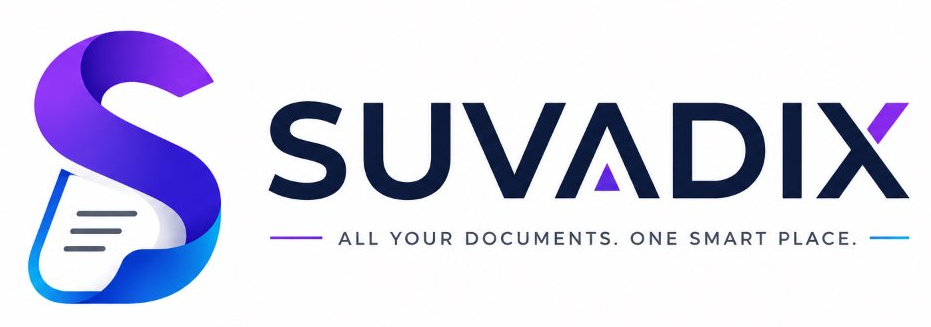

# SUVADIX — All Your Documents. One Smart Place.

  

> **A high-performance, private, 100% client-side document & PDF suite.**  
> Built with modern web standards, featuring an **All-In-One Studio** and dedicated workspaces running entirely in the browser via WebAssembly & JavaScript (`pdf-lib`, `pdf.js`, `tesseract.js`, `jszip`). Zero files are ever uploaded to external servers — ensuring complete privacy, zero latency queues, and unlimited free use.

🌐 **Live Website:** [https://editorakilan.github.io/PDFNova/](https://editorakilan.github.io/PDFNova/)

---

## 🌟 Flagship Highlight: All-In-One Studio

Located prominently on the dashboard, the **SUVADIX All-In-One Studio** allows you to perform every operation in a continuous workspace:
- **Organize & Instant Swap:** Visual page thumbnails, drag-and-drop reordering, and instant **Page A ⇄ Page B** swapping.
- **Dr. Vijayapriya Aki Digital Signatures:** Authentic cursive font signatures, freehand pen drawing, or transparent PNG image upload with draggable and resizable placement boxes.
- **Zero-Drift High-DPI Zoom Scaler:** Zoom in or out up to **250%** without losing resolution or misaligning signatures and watermarks (powered by normalized relative vector coordinates).
- **Text & Image Watermarking:** Configurable angle, opacity, font size, and 9-position anchor alignment.
- **Sentence Editing & Whiteouts:** Seamlessly redact, whiteout, or replace text across any document page.
- **Smart Target File Size Compressor:** Compress directly to your desired file size in `GB`, `MB`, `KB`, or `Bytes` with live reduction feedback.
- **AES-256 Encryption:** Protect sensitive documents with custom password protection.

---

## 🛠️ Complete Feature Suite

### 1. Organize PDF
- **Merge PDF:** Combine multiple PDFs into one unified document.
- **Split PDF:** Extract custom ranges (`1-3, 4-6`) or separate every page.
- **Organize PDF:** Visual thumbnails to reorder, delete, rotate, and swap pages instantly.
- **Remove Pages:** Delete unwanted pages with one click.
- **Extract Pages:** Pull specific page intervals into a new document.
- **Rotate PDF:** Rotate individual or all pages (90°, 180°, 270°).

### 2. Optimize & Intelligence
- **Compress PDF:** 3 quality presets + **Target File Size** mode (`GB`, `MB`, `KB`, `Bytes`).
- **OCR PDF & Q&A Assistant:** Optical Character Recognition (Tesseract.js) running locally with interactive question answering.

### 3. Convert to & from PDF
- **JPG to PDF:** Convert images with digital text layout and photo preservation.
- **Word to PDF:** Typeset `.docx` files into clean PDFs.
- **PDF to JPG / PNG / Text:** High-resolution image and plain-text extraction.

### 4. Edit & Security
- **Edit PDF & Sentences:** In-place sentence replacement and whiteout redaction boxes.
- **Sign PDF:** Digital signatures (Dr. Vijayapriya Aki cursive font, pen draw, upload).
- **Watermark PDF:** Add customized text and image watermarks.
- **Protect PDF:** AES-256 password encryption.
- **Unlock PDF:** Remove security permissions.

---

## 🔒 Privacy Guarantee
- **100% Client-Side:** All document rendering and manipulation happens locally in your device's memory.
- **Zero Server Uploads:** Documents never touch external cloud servers, databases, or APIs.
- **Completely Free:** Unlimited free usage without accounts, subscriptions, or daily limits.
